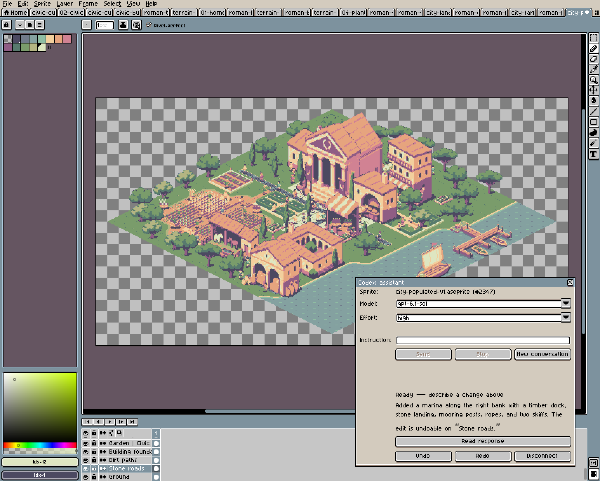
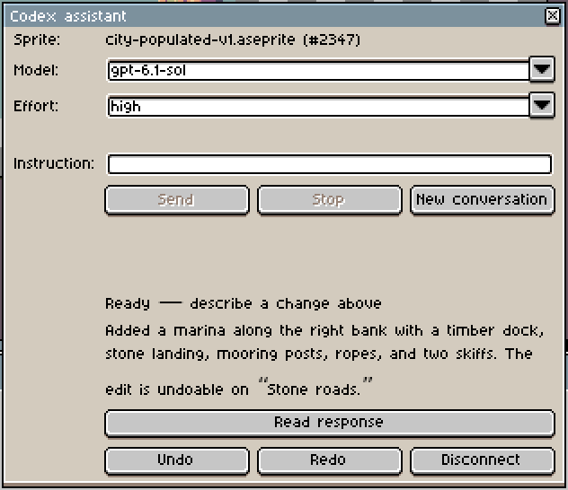
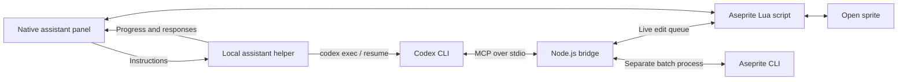

# Codex for Aseprite

**Iterate on pixel art from inside Aseprite.**

Open a sprite, choose a model and effort level, and describe the change you want.
The native **Codex assistant** panel keeps the conversation beside your artwork:
watch the canvas update, review the result, and send a follow-up.



*An actual editing session: the open artwork, model and effort controls, and the
assistant's response after adding a marina.*

This project now centers on the in-app editing loop. The existing Codex CLI / MCP
bridge remains available for automation, saving, exporting, and batch processing.
Both interfaces use the same live Aseprite connection and editing operations.

[Quick start](#quick-start) · [In-app assistant](#in-app-assistant) ·
[Example artwork](#example-artwork) · [Use from Codex CLI](#use-from-codex-cli) ·
[Troubleshooting](#troubleshooting) · [Development](#development)

## What you can do

- **Ask beside the canvas.** Enter an instruction and continue the conversation for each open sprite.
- **Choose how Codex works.** Select a model and a supported reasoning effort; your selections are remembered.
- **See when it is working.** An animated pixel spinner, elapsed time, and progress messages show an active request.
- **Review and revise.** Read the response, inspect the live result, and use Aseprite's Undo / Redo history.
- **Work on unsaved artwork.** Requests use the document open in the editor and stay pinned to its sprite ID.
- **Keep the CLI tools.** Inspect documents, run Lua, save layered files, export sheets, and process saved assets in batch mode.

You do not need to write Lua for everyday requests. The panel is installed as an
Aseprite script, with a local Node.js helper started once in a terminal. It uses
your existing Codex sign-in and model access, with no additional API key or hosted
bridge service. Aseprite and Codex must be installed separately.

## Before you start

- **macOS or Linux.** Native and Steam installations are supported; Windows is not supported.
- **Node.js 22 or newer and npm.** Used to install and run the local helper.
- **Codex CLI.** Installed, signed in, and working in your terminal.
- **Aseprite 1.3-series or newer.** Requires Lua and JSON scripting support.

**Verified setups:** Aseprite **1.3.18.6** on Linux using Steam Snap, and
**1.3.18.6-arm64** on macOS using Steam. The existing integration suite and live
editing, undo, previews, saving, and sprite-sheet export have passed on macOS.
The new assistant panel and its native controls have been checked on Linux; the
in-app workflow still needs equivalent macOS verification.

Check your terminal tools:

```sh
node --version
npm --version
codex --version
```

## Quick start

### 1. Install the scripts

Download or clone this project, then open a terminal **inside its folder**:

```sh
npm ci
npm run setup
```

Setup creates the local queue directory and installs the Lua scripts into detected
Aseprite script folders. It prints the installation paths and executable details.
`"connected": false` is expected until you open the panel.

If the executable is not found, see [Custom Aseprite executable](#custom-aseprite-executable).

### 2. Start the assistant helper

In that terminal, run:

```sh
npm run assistant
```

Leave it running while you use the panel. It should print **Aseprite assistant
ready**. This starts the helper; a model turn starts only when you press **Send**.

If `codex` is not on `PATH`, use its absolute path:

```sh
CODEX_BIN="/absolute/path/to/codex" npm run assistant
```

### 3. Open the panel in Aseprite

1. Open Aseprite and a sprite you want to edit.
2. Choose **File → Scripts → Rescan Scripts Folder**.
3. Choose **File → Scripts → codex-bridge**.
4. Allow file access when Aseprite prompts for the installed scripts.
5. Leave the **Codex assistant** panel open beside your artwork.

The panel shows the active sprite and **Ready — describe a change above** when
the helper is available. Closing the panel or pressing Esc only hides it; the
bridge keeps running. Choose **File → Scripts → codex-bridge** to show it again,
and click **Disconnect** to stop the connection. Connect only one Aseprite window
at a time.

### 4. Make a change and follow up

Choose a **Model** and **Effort**, then enter a small, specific edit:

> Add warm highlights to the rooftops on a new Highlights layer. Preserve the existing artwork.

Press **Send**, watch the result on the canvas, then refine it:

> Make those highlights more subtle and keep the palette consistent.

Review the canvas and response before saving. Save your document with Aseprite's
usual commands. For CLI access as well, see [Use from Codex CLI](#use-from-codex-cli).

## In-app assistant



The panel is a floating native dialog. Move it beside the canvas so you can keep
looking at the artwork while you ask for changes.

### The editing loop

1. **Describe the edit.** The single-line instruction field accepts your request for the open sprite.
2. **Send it.** A rotating pixel spinner and elapsed-time counter stay active while
   Codex works. Progress messages identify tool activity as it inspects and edits.
3. **Review the canvas.** The response appears in the panel; **Read response** opens the full message.
4. **Refine it.** Follow-ups keep the conversation for that sprite. Each open sprite
   has its own conversation until you disconnect or choose **New conversation**.

Try requests such as:

- “Add a small wooden dock along the riverbank on a new layer.”
- “Make the dock's shadow softer without changing the surrounding water.”
- “Add a Highlights layer above Body and keep the original layers intact.”
- “Set the idle animation frames to 150 ms each; leave the other tags unchanged.”
- On an open blank sprite: “Draw a small treasure chest, with the outline and colors on separate layers.”

Give Codex the target layer or region and any constraints you want it to preserve.
Requests capture the sprite ID, frame, layer, and selection bounds; Codex is
instructed to inspect the latest state before editing. MCP operations stay pinned
to the original sprite if you switch tabs. Save and export in Aseprite.

### Model and effort

The **Model** and **Effort** dropdowns apply to the next instruction, including
follow-ups in the same conversation. They initially use your effective Codex
configuration and remember later selections when you reopen the panel. Effort
choices match the selected model; an unsupported choice resets to that model's
default. Both controls are disabled during a request.

At startup, the helper queries Codex for available models, supported efforts, and
the project configuration. This metadata query does not start a model turn.
Restart `npm run assistant` to refresh the list after changing accounts or CLI
configuration. If discovery fails, the controls show **CLI default** and requests
continue using Codex's existing settings. The model shown in the screenshots is
an example from the account used for that session; your list may differ.

### Stop, undo, and save

**Stop** ends the running Codex process. Edits already applied remain on the
canvas, so inspect the result before retrying. **Undo** and **Redo** use Aseprite's
normal history and are disabled during a request. One instruction can create
several undo steps.

Save with Aseprite's usual commands. Avoid overlapping CLI edits or manual drawing
on the same sprite while a request is running.

The helper currently starts manually in a terminal. The instruction field is a
single line. The panel can be hidden while live requests continue; run the script
again to show it. More editing
buttons and sliders can be added to the same UI module.

## Example artwork


*A flattened preview of the same open city document, exported at 2× scale. The
marina is visible on the right bank. The screenshot above retains the actual
assistant response from that editing session.*

The [example images](docs/images/README.md) are checked into the repository so the
README can show the workflow and artwork without relying on external image hosts.
The editable source for this city is not included.

## Use from Codex CLI

The original CLI / MCP workflow is still supported. Global MCP registration is
optional for the in-app panel: its helper configures the Aseprite server for each
Codex invocation.

To use the bridge from your own Codex CLI conversations, run this inside the
project folder:

```sh
codex mcp add aseprite -- "$(command -v node)" "$PWD/src/server.mjs"
codex mcp get aseprite
```

The result should show `enabled: true`, `transport: stdio`, and the path to
`src/server.mjs`. Keep the project folder in place: Codex launches the server from
that path. You do not need to run `npm start` in another terminal.

Open the panel in Aseprite, start a **fresh Codex CLI session**, and check `/mcp`.
The `npm run assistant` helper is only required for the in-app instruction box;
the live CLI connection works while the bridge is connected, even without that helper.

Try asking:

> Check the Aseprite connection and tell me which sprites are open.

> Inspect my active sprite and show me a 4× preview of its first frame.

> Export this sprite as a horizontal PNG sheet and JSON metadata in my project's assets folder. Use absolute paths and report existing outputs before replacing them.

> Use batch mode to inspect `/absolute/path/to/hero.aseprite` and report its layers and tags.

See the [tool reference](#tool-reference) for the full MCP interface.

## Live editing or batch processing?

| | Live mode — default | Batch mode |
| --- | --- | --- |
| Works on | Documents open in the connected editor | A file loaded in a separate process |
| Sees unsaved GUI edits | Yes | No |
| Needs the live bridge connected | Yes; the panel can be hidden | No |
| Keeps document state between calls | Yes, while the document stays open | No; each call starts a fresh process |
| Best for | Drawing, iteration, reviewing changes together | Inspecting, converting, and exporting saved files |

**Batch scripts must save their changes before returning.** An unsaved document
created in a batch process disappears when that process exits. Live mode never
silently falls back to batch mode if the editor disconnects.

The in-app panel always uses live mode. Use a Codex CLI conversation for batch jobs.

## macOS installation notes

Setup installs the bridge into `~/Library/Application Support/Aseprite/scripts`.
The executable detector searches `PATH`, `/Applications/Aseprite.app`,
`~/Applications/Aseprite.app`, and the Steam libraries under
`~/Library/Application Support/Steam` (including additional libraries listed in
`libraryfolders.vdf`).

For a custom installation, set `ASEPRITE_BIN` to the executable **inside** the
app bundle, for example `/Applications/Aseprite.app/Contents/MacOS/aseprite`.
Quote paths containing spaces. The quick-start commands are the same on macOS
and Linux.

## Linux installation notes

The executable detector searches `PATH`, standard Steam library locations, and
additional libraries listed in `libraryfolders.vdf`.

Setup installs the script into these configuration locations:

| Installation | Script folder |
| --- | --- |
| Native / standard Steam | `$XDG_CONFIG_HOME/aseprite/scripts`, or `~/.config/aseprite/scripts` when unset |
| Steam Snap | `~/snap/steam/common/.config/aseprite/scripts` |
| Steam Flatpak | `~/.var/app/com.valvesoftware.Steam/config/aseprite/scripts` |

The native location is always created. Snap and Flatpak locations are used only
when their Aseprite configuration folders already exist. Launch Aseprite once
before setup if those folders have not been created yet.

Steam Flatpak detection is included, but its sandbox permissions have not been
verified end to end. Aseprite needs access to the shared queue and your project files.

If your scripts folder is elsewhere, use **File → Scripts → Open Scripts Folder**
to locate it. Copy both `codex-bridge.lua` and `codex-bridge-support/` from a folder
printed by setup into that location, then rescan scripts.

### Custom Aseprite executable

Set `ASEPRITE_BIN` to the actual executable, not a desktop shortcut or a Steam URL.
Replace the example path below with your installation path:

```sh
ASEPRITE_BIN="/absolute/path/to/aseprite" npm run setup

codex mcp add aseprite \
  --env ASEPRITE_BIN="/absolute/path/to/aseprite" \
  -- "$(command -v node)" "$PWD/src/server.mjs"
```

For CLI / batch use, passing `--env` stores the override for future MCP launches.
Setting it only on the setup command does not configure Codex's server environment.

### Custom shared directory

The default queue is `~/aseprite-bridge-data`. It is a visible home-directory
folder so Steam Snap can access it, with permissions restricted to its owner
(`0700`). It must be owned by your current user and must not be a symlink.

To change it, use the **same absolute path** for setup and the assistant helper:

```sh
ASEPRITE_BRIDGE_DIR="$HOME/aseprite-shared" npm run setup
ASEPRITE_BRIDGE_DIR="$HOME/aseprite-shared" npm run assistant
```

For optional CLI / MCP access, register the server with that directory too:

```sh
codex mcp add aseprite \
  --env ASEPRITE_BRIDGE_DIR="$HOME/aseprite-shared" \
  -- "$(command -v node)" "$PWD/src/server.mjs"
```

If you also need `ASEPRITE_BIN`, include both `--env` options in the registration
command. After changing configuration, restart the helper and reconnect the
Aseprite script. Start a fresh Codex CLI session if you use the optional MCP route.

## Troubleshooting

| Symptom | What to check |
| --- | --- |
| “Start the helper with npm run assistant” | Run `npm run assistant` inside the project and keep that terminal open. Check that setup and the helper use the same queue directory. |
| Model / effort controls are disabled while idle | Restart the helper after updating. If model discovery failed, check that Codex is signed in and working in your terminal, then restart the helper. |
| New panel controls are missing after an update | Click **Disconnect**, run `npm run setup`, and reopen **File → Scripts → codex-bridge**. Restart the helper to load Node.js changes. |
| Codex executable is not found | Set `CODEX_BIN` to the absolute CLI path when starting the helper. |
| Codex does not list `aseprite` | Run `codex mcp get aseprite`. Confirm the Node and server paths still exist, then start a fresh Codex session and check `/mcp`. |
| `codex-bridge` is missing from Aseprite's menu | Run `npm run setup`, rescan scripts, and compare the printed installation path with **Open Scripts Folder**. |
| “Live bridge is offline” | Run the script in the Aseprite window you want to use and leave its dialog open. Check for pending Aseprite permission prompts. |
| The dialog says connected, but requests time out | Allow pending file-access prompts and dismiss blocking dialogs. Confirm both sides use the same `ASEPRITE_BRIDGE_DIR`. |
| “Another Aseprite window already owns the Codex bridge” | Disconnect the other window first. After a crash, wait at least five seconds before reconnecting. |
| “Aseprite not found” | Configure `ASEPRITE_BIN` using the executable's absolute path. Check that running that path with `--version` succeeds. |
| “No active sprite” | Open or create a document in the connected editor, or supply an input file for batch mode. |
| “Output exists” | Choose a new output path, or explicitly ask to overwrite it. Save/export require `overwrite: true`. |
| “Output parent directory does not exist” | Create the destination folder first. Save/export do not create it. |
| A preview is too large | Reduce the scale. Preview scale is an integer from 1–16, dimensions are capped at 4096×4096, and PNG content at 10 MB. |
| “Outcome unknown” after a timeout | Inspect the sprite before retrying: the edit may already have happened or may still finish. The error includes the retained job directory. |
| An older script reports a heartbeat `Input/output error` | Update the project, click **Disconnect**, run `npm run setup`, and run the script again. The current version handles Aseprite's file-replacement behavior. |

For a connection report, ask Codex to call `aseprite_status`. It reports the queue
directory, live connection state, executable path, version, and any batch detection error.

## Tool reference

The assistant uses the inspect, preview, and Lua tools to edit the open document.
Saving, exporting, opening other documents, and batch operations are available
through the standalone CLI / MCP interface. The details below are useful when
writing precise prompts, integrating another MCP client, or extending the bridge.

| Tool | Purpose | Mode |
| --- | --- | --- |
| `aseprite_status` | Check the live connection and executable detection | Independent |
| `aseprite_inspect` | Read sprite IDs, dimensions, layers, frames, durations, and tags | Live / batch |
| `aseprite_open` | Open a file without closing existing documents | Live |
| `aseprite_run_lua` | Execute Lua with the full Aseprite API | Live / batch |
| `aseprite_preview` | Return a flattened PNG as MCP image content | Live / batch |
| `aseprite_save` | Save a layered `.aseprite` or `.ase` document | Live / batch |
| `aseprite_export_sheet` | Export a horizontal PNG sheet and optional JSON metadata | Live / batch |

### Common arguments

- `mode`: `"live"` by default, or `"batch"` for a separate process.
- `input`: absolute input filename, for batch operations only.
- `sprite_id`: live document ID returned by inspect. Pins the target even if you switch tabs; otherwise the active document is used when the request executes.
- `path`: absolute output filename for save/export, or input filename for open. Output parent folders must already exist.
- `overwrite`: defaults to `false` for save/export. Set it explicitly to replace existing output.

Preview takes optional `frame` and `scale` arguments. Frame numbers start at
**1**; scale defaults to **1**. Sheet export accepts an optional `data_path` ending
in `.json`. The built-in sheet tool exports horizontally; other layouts require Lua.

### Lua and undo

`aseprite_run_lua` takes `code`, an optional undo `label`, and `transaction`
(default `true`). It can return JSON-compatible values: strings, numbers,
booleans, and plain tables.

Edits to an existing sprite are wrapped in an Aseprite transaction by default.
With no open sprite, the script runs directly so it can create one. Set
`transaction: false` when managing transactions yourself or calling Undo/Redo.

For undoable pixel edits, modify an image clone and assign it back to the cel:

```lua
local cel = assert(app.cel, "Select a cel first")
local image = cel.image:clone()

image:drawPixel(0, 0, app.pixelColor.rgba(255, 128, 64, 255))
cel.image = image

return { layer = cel.layer.name }
```

Here `(0, 0)` is relative to the cel's image. Direct `drawPixel` calls on an
existing cel image do not create undo history. Transactions do not undo external
file writes or guarantee rollback across multiple documents. Keep scripts short
and avoid blocking loops or dialogs.

## How it works



The panel writes an instruction and its document context to a local queue. The
helper starts or resumes Codex, passes the selected model and effort, and reports
progress back to the panel. Codex calls the same Aseprite MCP tools used by the
standalone CLI workflow.

The live script checks the edit queue every 200 ms. Each tool request has a unique ID,
connection session, and expiry time. Aseprite claims a request before executing
it, then returns JSON and, for previews, a PNG. Batch jobs are kept separate from
the live queue.

Each Aseprite tool request has a default timeout of 15 seconds. A whole assistant
instruction can run for up to 10 minutes; **Stop** can end it sooner. Unclaimed live
requests are cancelled; claimed requests can still complete and are retained for diagnosis if they time
out. Edits are never retried automatically, and requests from an earlier connection
cannot execute in a new session.

Completed assistant requests are removed after the panel reads them. Interrupted
requests may remain under `assistant-job-*` in the queue for diagnosis. Only one
assistant helper may own a queue at a time.

The bridge is trusted local automation: Lua has Aseprite's scripting and file
access capabilities. Save/export overwrite checks do not restrict arbitrary Lua.
Aseprite's permission prompts remain enabled. The bridge itself opens no network
listener; tool results and previews are returned to Codex for use in the conversation.

## Updating and uninstalling

To update, finish or stop any running request, click **Disconnect**, and stop the helper
with Ctrl+C. Get the updated project files, then run:

```sh
npm ci
npm run setup
npm run assistant
```

Open **File → Scripts → codex-bridge** again. For optional CLI / MCP use, start a
fresh Codex session. If you moved the project or changed the Node executable,
repeat the registration command in [Use from Codex CLI](#use-from-codex-cli).

To uninstall:

1. Click **Disconnect** in the **Codex assistant** panel and stop the helper with Ctrl+C if running.
2. Run `codex mcp remove aseprite` if you registered the optional CLI server.
3. Remove `codex-bridge.lua` and `codex-bridge-support/` from the script folders printed by setup, then rescan scripts.
4. Optionally remove the project folder and shared queue after checking for files you want to keep. Live smoke-test outputs are in `artifacts/`.

Removing the bridge does not require removing Aseprite or Codex.

## Development

Install Node.js 22 or newer, npm, Aseprite, and Codex CLI as listed above, then
run `npm ci`. The server runs directly from JavaScript source; no build step is
required. `npm start` starts the MCP stdio server, which normally runs under
Codex through the registration in the quick start.

```text
aseprite-codex-bridge/
├── docs/images/            # README screenshots and example artwork
├── src/
│   ├── server.mjs          # MCP tools, validation, and image responses
│   ├── bridge.mjs          # Executable detection, queue, and process management
│   ├── assistant.mjs       # In-app request queue and background Codex runner
│   └── codex-settings.mjs  # CLI model discovery and effective defaults
├── aseprite/
│   ├── codex-bridge.lua    # Live connection dialog and polling timer
│   ├── core.lua           # Shared Aseprite operations
│   ├── assistant.lua      # Native instruction panel and request context
│   └── batch.lua          # Batch entry point
├── scripts/
│   ├── setup.mjs          # Install the Lua scripts
│   └── live-smoke.mjs     # Exercise the connected GUI
└── test/
    ├── bridge.test.mjs    # Real Aseprite and MCP integration tests
    └── assistant.test.mjs # Runner, cancellation, panel state, and target checks
```

Run the automated suite with an Aseprite executable available:

```sh
npm test
```

The bridge tests cover repeated heartbeat writes, sprite creation and editing,
layers/frames/tags, previews, saving and export, overwrite refusal, Lua errors,
transaction rollback, offline handling, timeout cancellation, and an MCP stdio
handshake with image responses. They use real Aseprite processes. Assistant tests
exercise the runner with a fake Codex executable, model discovery, model/effort
switching, cancellation, thread resumption, queue ownership, and target validation.
The panel state test uses real Aseprite document objects with test dialog controls
in batch mode. These do not call a
model or verify the native panel's visual appearance; test those in the live GUI.

README images live in `docs/images/` and are tracked in git. Capture instructions
and image provenance are in [the image notes](docs/images/README.md). Temporary
smoke-test outputs and discarded captures belong in ignored `artifacts/`.

To check the live connection:

```sh
node scripts/live-smoke.mjs
```

This creates a new test sprite, checks editing and undo, saves a preview and
exports under `artifacts/`, and leaves the test sprite open. It does not edit
existing documents. Re-run `npm run setup` after modifying Lua source so the
installed scripts match your checkout.

When reporting a problem, include your macOS version or Linux distribution, Aseprite version and
installation method, Node version, the tool or command that failed, and the
exact error. A redacted `aseprite_status` result can help identify path problems.

## Further reading

- [Codex MCP configuration](https://learn.chatgpt.com/docs/extend/mcp?surface=cli)
- [Aseprite scripting API](https://www.aseprite.org/api/)
- [Aseprite command-line interface](https://www.aseprite.org/docs/cli/)
- [Aseprite Timer API](https://www.aseprite.org/api/timer)
