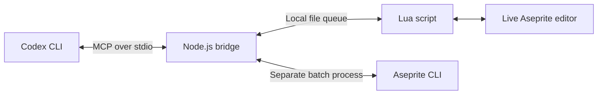

# Aseprite ↔ Codex CLI

**Talk to Codex. Watch your sprites change in Aseprite.**

A Linux bridge for working on pixel art with Codex CLI. Inspect the document you
have open, edit layers and pixels through Lua, preview the result, and export
assets for your game—all from a conversation.

The bridge runs locally and connects through **MCP** (Model Context Protocol),
which gives Codex tools it can call. You do not need to write Lua to get started.

[Quick start](#quick-start) · [Example prompts](#example-prompts) ·
[Troubleshooting](#troubleshooting) · [Tool reference](#tool-reference) ·
[Development](#development)

## What you can do

- **Work in the live editor.** Inspect and edit open documents, including unsaved changes.
- **See the result.** Return a flattened PNG preview of any animation frame to Codex.
- **Automate repetitive edits.** Use Aseprite's Lua API for layers, pixels, frames, and tags.
- **Save editable source files.** Keep layers and animation in `.aseprite` or `.ase` format.
- **Export game assets.** Generate a horizontal PNG sprite sheet with optional JSON metadata.
- **Process files in the background.** Run batch jobs without opening the Aseprite GUI.

The bridge needs no separate API key, hosted service, or listening network port.
Codex still uses your existing sign-in and model access; Aseprite must be installed separately.

## Before you start

| Requirement | Details |
| --- | --- |
| Linux | This project targets Linux. Other operating systems are not tested. |
| Node.js and npm | Node.js **22 or newer**; npm installs the bridge dependencies. |
| Codex CLI | Installed and working in your terminal. |
| Aseprite | A **1.3-series or newer** build with Lua and JSON scripting support. |

**Verified setup:** Aseprite **1.3.18.6** on Linux, using the executable supplied
by Steam Snap. Live editing, undo, previews, saving, and sprite-sheet export have
been exercised against that installation. Other packaging variants need local verification.

Check your terminal tools:

```sh
node --version
npm --version
codex --version
```

## Quick start

### 1. Install the bridge

Download or clone this project, then open a terminal **inside its folder**:

```sh
npm ci
npm run setup
```

Setup creates the local queue directory and installs the Lua script into the
detected Aseprite script folders. It prints each installation path and the
detected Aseprite executable. `"connected": false` is expected before step 3.

If the executable is not found, see [Custom Aseprite executable](#custom-aseprite-executable).

### 2. Register it with Codex

Run this from the same project folder:

```sh
codex mcp add aseprite -- "$(command -v node)" "$PWD/src/server.mjs"
codex mcp get aseprite
```

The second command should show `enabled: true`, `transport: stdio`, and the path
to `src/server.mjs`. This registers the bridge globally for your Codex CLI user.

Keep the project folder in place: Codex launches the server from this path.
You do **not** need to run `npm start` in another terminal.

### 3. Connect your Aseprite window

1. Open Aseprite.
2. Choose **File → Scripts → Rescan Scripts Folder**.
3. Choose **File → Scripts → codex-bridge**.
4. Allow file access when Aseprite prompts for the installed bridge scripts.
5. Leave the **Codex bridge** dialog open.

The dialog should say **Connected — ready for Codex**. Closing it disconnects
the live editor. Connect only one Aseprite window at a time.

### 4. Try your first prompt

Start a **fresh Codex CLI session**. Run `/mcp` and check that `aseprite` is available.
Then ask:

> Check the Aseprite bridge connection and tell me which sprites are open.

With a sprite open, try:

> Inspect my active Aseprite sprite and show me a 4× preview of its first frame.

You should get document details and a preview through the bridge. You're ready
to work on sprites together.

## Example prompts

Give Codex a specific change, the document or layer it should affect, and any
constraints you want it to preserve.

| Task | Try asking Codex |
| --- | --- |
| Understand a sprite | “List the layers, animation tags, and frame durations in my active Aseprite document.” |
| Create a new asset | “Create a new 32×32 sprite with a small treasure chest on a transparent background. Put the outline and colors on separate layers, then show me a preview.” |
| Edit an existing asset | “Add a Highlights layer above Body in the open sprite. Keep the existing layers intact and make the edit undoable.” |
| Adjust animation | “Set the frames in the idle tag to 150 ms each. Leave the other frame durations unchanged.” |
| Review a change | “Show me frame 2 at 8× scale so we can inspect the edges.” |
| Export for a game | “Export this sprite as a horizontal PNG sheet and JSON metadata in my project's assets folder. Use absolute paths and tell me if either output already exists.” |
| Work without the GUI | “Use Aseprite batch mode to inspect `/absolute/path/to/hero.aseprite` and report its layers and animation tags.” |

These are workflow examples, not fixed commands: Codex uses the tools and Lua API
to carry out your request. Review the preview before saving an important edit.

## Live editing or batch processing?

| | Live mode — default | Batch mode |
| --- | --- | --- |
| Works on | Documents open in the connected editor | A file loaded in a separate process |
| Sees unsaved GUI edits | Yes | No |
| Needs the bridge dialog open | Yes | No |
| Keeps document state between calls | Yes, while the document stays open | No; each call starts a fresh process |
| Best for | Drawing, iteration, reviewing changes together | Inspecting, converting, and exporting saved files |

**Batch scripts must save their changes before returning.** An unsaved document
created in a batch process disappears when that process exits. Live mode never
silently falls back to batch mode if the editor disconnects.

For everyday use, leave live mode enabled and tell Codex when you want a background job.

## Linux installation notes

The executable detector searches `PATH`, standard Steam library locations, and
additional libraries listed in `libraryfolders.vdf`.

Setup installs the script into these configuration locations:

| Installation | Script folder |
| --- | --- |
| Native / standard Steam | `$XDG_CONFIG_HOME/aseprite/scripts`, or `~/.config/aseprite/scripts` when unset |
| Steam Snap | `~/snap/steam/common/.config/aseprite/scripts` |
| Steam Flatpak | `~/.var/app/com.valvesoftware.Steam/config/aseprite/scripts` |

The native location is always created. Snap and Flatpak locations are used only
when their Aseprite configuration folders already exist. Launch Aseprite once
before setup if those folders have not been created yet.

Steam Flatpak detection is included, but its sandbox permissions have not been
verified end to end. Aseprite needs access to the shared queue and your project files.

If your scripts folder is elsewhere, use **File → Scripts → Open Scripts Folder**
to locate it. Copy both `codex-bridge.lua` and `codex-bridge-support/` from a folder
printed by setup into that location, then rescan scripts.

### Custom Aseprite executable

Set `ASEPRITE_BIN` to the actual executable, not a desktop shortcut or a Steam URL.
Replace the example path below with your installation path:

```sh
ASEPRITE_BIN="/absolute/path/to/aseprite" npm run setup

codex mcp add aseprite \
  --env ASEPRITE_BIN="/absolute/path/to/aseprite" \
  -- "$(command -v node)" "$PWD/src/server.mjs"
```

Passing `--env` stores the override for future MCP launches. Setting it only
on the setup command does not configure Codex's server environment.

### Custom shared directory

The default queue is `~/aseprite-bridge-data`. It is a visible home-directory
folder so Steam Snap can access it, with permissions restricted to its owner
(`0700`). It must be owned by your Linux user and must not be a symlink.

To change it, use the **same absolute path** for setup and the MCP server:

```sh
ASEPRITE_BRIDGE_DIR="$HOME/aseprite-shared" npm run setup

codex mcp add aseprite \
  --env ASEPRITE_BRIDGE_DIR="$HOME/aseprite-shared" \
  -- "$(command -v node)" "$PWD/src/server.mjs"
```

If you also need `ASEPRITE_BIN`, include both `--env` options in the registration
command. After changing configuration, reconnect the Aseprite script and start
a fresh Codex session.

## Troubleshooting

| Symptom | What to check |
| --- | --- |
| Codex does not list `aseprite` | Run `codex mcp get aseprite`. Confirm the Node and server paths still exist, then start a fresh Codex session and check `/mcp`. |
| `codex-bridge` is missing from Aseprite's menu | Run `npm run setup`, rescan scripts, and compare the printed installation path with **Open Scripts Folder**. |
| “Live bridge is offline” | Run the script in the Aseprite window you want to use and leave its dialog open. Check for pending Aseprite permission prompts. |
| The dialog says connected, but requests time out | Allow pending file-access prompts and dismiss blocking dialogs. Confirm both sides use the same `ASEPRITE_BRIDGE_DIR`. |
| “Another Aseprite window already owns the Codex bridge” | Disconnect the other window first. After a crash, wait at least five seconds before reconnecting. |
| “Aseprite not found” | Configure `ASEPRITE_BIN` using the executable's absolute path. Check that running that path with `--version` succeeds. |
| “No active sprite” | Open or create a document in the connected editor, or supply an input file for batch mode. |
| “Output exists” | Choose a new output path, or explicitly ask to overwrite it. Save/export require `overwrite: true`. |
| “Output parent directory does not exist” | Create the destination folder first. Save/export do not create it. |
| A preview is too large | Reduce the scale. Preview scale is an integer from 1–16, dimensions are capped at 4096×4096, and PNG content at 10 MB. |
| “Outcome unknown” after a timeout | Inspect the sprite before retrying: the edit may already have happened or may still finish. The error includes the retained job directory. |
| An older script reports a heartbeat `Input/output error` | Update the project, run `npm run setup`, close the old dialog, and run the script again. The current version handles Aseprite's file-replacement behavior. |

For a connection report, ask Codex to call `aseprite_status`. It reports the queue
directory, live connection state, executable path, version, and any batch detection error.

## Tool reference

Codex chooses these tools for you. The details below are useful when writing
precise prompts, integrating another MCP client, or extending the bridge.

| Tool | Purpose | Mode |
| --- | --- | --- |
| `aseprite_status` | Check the live connection and executable detection | Independent |
| `aseprite_inspect` | Read sprite IDs, dimensions, layers, frames, durations, and tags | Live / batch |
| `aseprite_open` | Open a file without closing existing documents | Live |
| `aseprite_run_lua` | Execute Lua with the full Aseprite API | Live / batch |
| `aseprite_preview` | Return a flattened PNG as MCP image content | Live / batch |
| `aseprite_save` | Save a layered `.aseprite` or `.ase` document | Live / batch |
| `aseprite_export_sheet` | Export a horizontal PNG sheet and optional JSON metadata | Live / batch |

### Common arguments

- `mode`: `"live"` by default, or `"batch"` for a separate process.
- `input`: absolute input filename, for batch operations only.
- `sprite_id`: live document ID returned by inspect. Pins the target even if you switch tabs; otherwise the active document is used when the request executes.
- `path`: absolute output filename for save/export, or input filename for open. Output parent folders must already exist.
- `overwrite`: defaults to `false` for save/export. Set it explicitly to replace existing output.

Preview takes optional `frame` and `scale` arguments. Frame numbers start at
**1**; scale defaults to **1**. Sheet export accepts an optional `data_path` ending
in `.json`. The built-in sheet tool exports horizontally; other layouts require Lua.

### Lua and undo

`aseprite_run_lua` takes `code`, an optional undo `label`, and `transaction`
(default `true`). It can return JSON-compatible values: strings, numbers,
booleans, and plain tables.

Edits to an existing sprite are wrapped in an Aseprite transaction by default.
With no open sprite, the script runs directly so it can create one. Set
`transaction: false` when managing transactions yourself or calling Undo/Redo.

For undoable pixel edits, modify an image clone and assign it back to the cel:

```lua
local cel = assert(app.cel, "Select a cel first")
local image = cel.image:clone()

image:drawPixel(0, 0, app.pixelColor.rgba(255, 128, 64, 255))
cel.image = image

return { layer = cel.layer.name }
```

Here `(0, 0)` is relative to the cel's image. Direct `drawPixel` calls on an
existing cel image do not create undo history. Transactions do not undo external
file writes or guarantee rollback across multiple documents. Keep scripts short
and avoid blocking loops or dialogs.

## How it works



The live script checks the queue every 200 ms. Each request has a unique ID,
connection session, and expiry time. Aseprite claims a request before executing
it, then returns JSON and, for previews, a PNG. Batch jobs are kept separate from
the live queue.

The default request timeout is 15 seconds. Unclaimed live requests are cancelled;
claimed requests can still complete and are retained for diagnosis if they time
out. Edits are never retried automatically, and requests from an earlier connection
cannot execute in a new session.

The bridge is trusted local automation: Lua has Aseprite's scripting and file
access capabilities. Save/export overwrite checks do not restrict arbitrary Lua.
Aseprite's permission prompts remain enabled. The bridge itself opens no network
listener; tool results and previews are returned to Codex for use in the conversation.

## Updating and uninstalling

To update, close the bridge dialog, get the updated project files, and run:

```sh
npm ci
npm run setup
```

Run the Aseprite script again and start a fresh Codex session. If you moved the
project or changed the Node executable, repeat the registration command from
the quick start.

To uninstall:

1. Close the **Codex bridge** dialog.
2. Run `codex mcp remove aseprite`.
3. Remove `codex-bridge.lua` and `codex-bridge-support/` from the script folders printed by setup, then rescan scripts.
4. Optionally remove the project folder and shared queue after checking for files you want to keep. Live smoke-test outputs are in `artifacts/`.

Removing the bridge does not require removing Aseprite or Codex.

## Development

```text
aseprite-codex-bridge/
├── src/
│   ├── server.mjs          # MCP tools, validation, and image responses
│   └── bridge.mjs          # Executable detection, queue, and process management
├── aseprite/
│   ├── codex-bridge.lua    # Live connection dialog and polling timer
│   ├── core.lua           # Shared Aseprite operations
│   └── batch.lua          # Batch entry point
├── scripts/
│   ├── setup.mjs          # Install the Lua scripts
│   └── live-smoke.mjs     # Exercise the connected GUI
└── test/
    └── bridge.test.mjs    # Real Aseprite and MCP integration tests
```

Run the automated suite with an Aseprite executable available:

```sh
npm test
```

The six tests cover repeated heartbeat writes, sprite creation and editing,
layers/frames/tags, previews, saving and export, overwrite refusal, Lua errors,
transaction rollback, offline handling, timeout cancellation, and an MCP stdio
handshake with image responses. They use real Aseprite processes.

To check the live connection:

```sh
node scripts/live-smoke.mjs
```

This creates a new test sprite, checks editing and undo, saves a preview and
exports under `artifacts/`, and leaves the test sprite open. It does not edit
existing documents. Re-run `npm run setup` after modifying Lua source so the
installed scripts match your checkout.

When reporting a problem, include your Linux distribution, Aseprite version and
installation method, Node version, the tool or command that failed, and the
exact error. A redacted `aseprite_status` result can help identify path problems.

## Further reading

- [Codex MCP configuration](https://learn.chatgpt.com/docs/extend/mcp?surface=cli)
- [Aseprite scripting API](https://www.aseprite.org/api/)
- [Aseprite command-line interface](https://www.aseprite.org/docs/cli/)
- [Aseprite Timer API](https://www.aseprite.org/api/timer)
